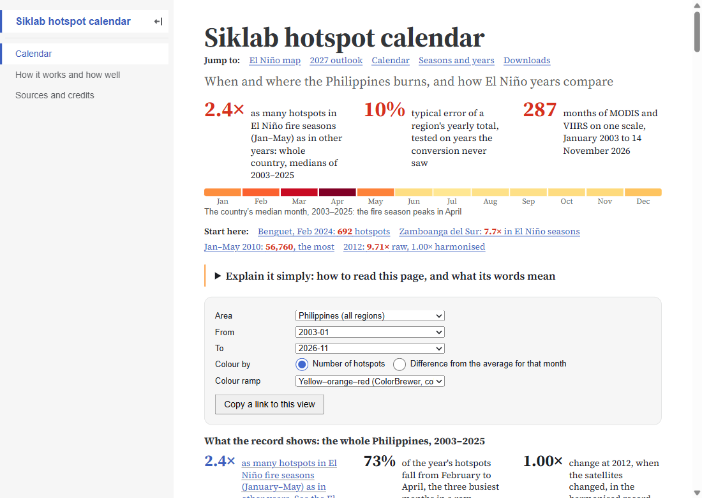

# Siklab hotspot calendar



A harmonised burning activity calendar for the Philippines, built from NASA FIRMS active fire hotspots during the NASA Space Apps Challenge 2026 (14–15 November 2026, Manila local event, challenge "Harmonization of MODIS and VIIRS Hot Spots") by team Siklab.

MODIS and VIIRS count fire very differently: over the Philippines, VIIRS on Suomi NPP reports about ten hotspots for every one that MODIS on Aqua reports. This project converts the MODIS record (2003 to January 2012) onto the VIIRS scale with a factor per region, fitted on the years both satellites flew, so that one monthly series runs from January 2003 to the latest month for any of the 17 regions and 87 province-level areas (81 provinces, Metro Manila's four districts, Isabela City and Cotabato City), or for a box drawn on the map.

- **Live application:** https://rvbcosme.github.io/siklab-hotspot-calendar/ (no login). **Demo, 7 slides:** https://rvbcosme.github.io/siklab-hotspot-calendar/demo, also as a PDF in `src/siklab-demo-slides.pdf`.
- **Web application:** a static site built with Observable Framework (`src/`): the calendar, a province map of the same selection, a summary in plain words, charts, downloads, and links that reopen the same view. Screenshots are in `src/img/`.
- **Data pipeline:** `pipeline/build-data.mjs` (Node.js, no dependencies) turns the FIRMS yearly country files into the files in `src/data/`, including the harmonised count of every day (`daily.csv`) and the fire radiative power of the VIIRS hotspots by month (`intensity.csv`), and runs the validation tests. `pipeline/build-findings.mjs` then computes, from the harmonised record, the El Niño response of every area (`elnino.json`: January–May seasons of El Niño years against the others, 2003–2025, with a permutation test) the step across the change of sensor (`seam.json`) and the El Niño outlook (`outlook.json`).
- **Finding:** in El Niño years (NOAA Oceanic Niño Index, January–March +0.5 or more) the country's January–May fire season had a median of 2.4 times the hotspots of other years; the ratio holds inside the MODIS years and the VIIRS years alone. El Niño years are also less cloudy, so the ratio mixes more burning with better visibility; it describes past seasons and is not a forecast. Details on the method page.
- **Outlook:** if January–May 2027 is an El Niño season, as PAGASA expects, the calendar page shows for each area with enough fires the range of its past El Niño seasons, tested by predicting each past El Niño season from the others; it is a range from past seasons, not a forecast model.
- **Method and validation results:** `src/method.md`, shown on the site's "How it works and how well" page.

## Rebuild from scratch

```sh
npm ci
# 1. Download the FIRMS yearly country files for the Philippines into data/raw/firms/
#    https://firms.modaps.eosdis.nasa.gov/data/country/{modis|viirs-snpp|viirs-jpss1}/{year}/{sensor}_{year}_Philippines.csv
#    MODIS 2000-2025, VIIRS Suomi NPP 2012-2025, VIIRS NOAA-20 2018-2025 (no login needed)
# 2. Download the FIRMS missing-data table to data/raw/firms_missing_data.json
#    https://firms.modaps.eosdis.nasa.gov/api/missing_data/?action=fetch_data
# 3. Download geoBoundaries PHL ADM1 and ADM2 simplified GeoJSON to data/raw/geoboundaries/
#    (PHL-ADM1_simplified.geojson, PHL-ADM2_simplified.geojson), release 41af8f1
# 4. Optional, for 2026: put FIRMS_MAP_KEY=<your free FIRMS map key> in .env (git-ignored), then
node pipeline/fetch-2026.mjs   # FIRMS area API, 1 Jan 2026 to yesterday (UTC); near-real-time files are replaced each run; the key is never printed
npm run data     # builds src/data/* and the findings (about one minute)
npm run build    # builds the static site into dist/
```

## Data and licences

- Hotspots: NASA FIRMS (MODIS Collection 6.1; VIIRS 375 m, Suomi NPP and NOAA-20). We acknowledge the use of data from NASA's Fire Information for Resource Management System (FIRMS), part of NASA's Earth Science Data and Information System (ESDIS).
- Boundaries: geoBoundaries, Philippines ADM1 and ADM2 (2020), CC BY 3.0 IGO. Runfola, D. et al. (2020) geoBoundaries: A global database of political administrative boundaries. PLoS ONE 15(4): e0231866.
- El Niño years: NOAA Climate Prediction Center, Oceanic Niño Index, https://www.cpc.ncep.noaa.gov/data/indices/oni.ascii.txt (U.S. Government work).
- Software: Observable Framework 1.13.4 (ISC) and its bundled libraries.
- This project's code: Apache License 2.0 (see `LICENSE`). Derived data files follow the terms of their sources.

## Use of AI

Code, data files, text and the screenshots in `src/img/` were written, generated or taken with the help of an AI assistant (Claude Code, Anthropic). The Team Owner reviewed the approach, made the open decisions and published each change. The full record of what the assistant did, the checks run on the data, and what people decided is on the site's Sources page.
