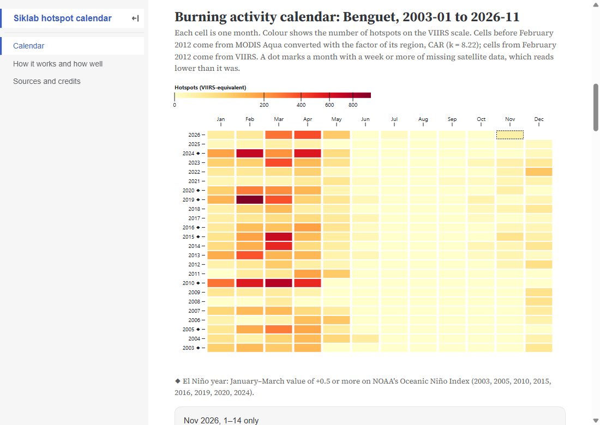

<!-- Written with AI assistance (Claude Code, Anthropic) during NASA Space Apps 2026, 14 Nov 2026; see README. -->

```js
const monthlyRaw = FileAttachment("data/monthly.csv").csv();
const v = FileAttachment("data/validation.json").json();
const meta = FileAttachment("data/meta.json").json();
const seam = FileAttachment("data/seam.json").json();
const heldout = FileAttachment("data/heldout.json").json();
const elnino = FileAttachment("data/elnino.json").json();
const areas = FileAttachment("data/areas.json").json();
const provinceShapes = FileAttachment("data/provinces.json").json();
```

```js
const rows = monthlyRaw.map((d) => ({id: d.area_id, month: d.month, year: +d.month.slice(0, 4), m: +d.month.slice(5, 7), h: +d.hotspots_harmonised, aqua: +d.modis_aqua, snpp: +d.viirs_snpp}));
const benguet = rows.filter((d) => d.id === "p-benguet");
const ph = rows.filter((d) => d.id === "ph");
const lastYear = d3.max(ph, (d) => d.year);
const fmt = d3.format(",.0f");
const T1 = v.T1_leaveOneYearOut_2012_2020;
// Remove Plot's per-layer labels (<g aria-label="bar">); each chart is described by the slide text (as on the calendar page).
const quiet = (node) => (node.querySelectorAll("g[aria-label]").forEach((g) => g.removeAttribute("aria-label")), node);
```

<p class="deck-help"><a href="./siklab-demo-slides.pdf" download>Download these 7 slides as a PDF</a> · Arrow keys move between slides.</p>

<div class="slide title-slide">
  <p class="kicker">NASA Space Apps Challenge 2026 · Harmonization of MODIS and VIIRS Hot Spots · Manila</p>
  <h1>One fire calendar for the Philippines, whichever satellite saw the fire</h1>
  <p class="who">Team Siklab: Rene Vincent Cosme, Prince Zablan, Charles Derick Yu and Gerardo Razon III</p>
  <p class="slide-no">1 / 7</p>
</div>

<div class="slide">
  <h2>The problem: the record breaks in 2012</h2>

```js
const raw = ph.filter((d) => d.year >= 2008 && d.year <= 2016).flatMap((d) => [
  {t: new Date(d.month + "-15"), v: d.aqua, s: "MODIS Aqua (since 2002)"},
  ...(d.year >= 2012 ? [{t: new Date(d.month + "-15"), v: d.snpp, s: "VIIRS Suomi NPP (since 2012)"}] : [])
]);
display(quiet(Plot.plot({width: 900, height: 250, marginLeft: 56, style: {fontSize: "14px"}, y: {label: "Hotspots per month, raw", grid: true}, x: {label: null}, color: {legend: true, range: ["#888", "#d7301f"]}, marks: [Plot.lineY(raw, {x: "t", y: "v", stroke: "s", strokeWidth: 2}), Plot.ruleY([0])]})));
```

  <p class="say">Same fires, two sensors: VIIRS counts about ${Math.round(meta.factors.ph.k)} hotspots for every one MODIS Aqua counts over the Philippines. Laid end to end, the average year after the switch (${seam.after.join("–")}) is <b>${seam.areas.ph.raw.toFixed(2)}×</b> the average year before it (${seam.before.join("–")}): the instrument changed, not the burning.</p>
  <p class="slide-no">2 / 7</p>
</div>

<div class="slide">
  <h2>What we built: a harmonised burning activity calendar</h2>
  <div class="shot">
    
    <p class="say">The live app's calendar for Benguet, one cell per month since 2003. Choose the country, any of ${areas.filter((a) => a.level === "region").length} regions or ${areas.filter((a) => a.level === "province").length} province-level areas, a box on a NASA map, or click a province on the app's map. Each view is explained in plain words, and the numbers, hotspots and charts can be downloaded.</p>
  </div>
  <p class="slide-no">3 / 7</p>
</div>

<div class="slide">
  <h2>How: put MODIS on the VIIRS scale, region by region</h2>
  <div class="steps">
    <div><b>1</b> NASA FIRMS hotspots, MODIS and VIIRS, filtered the same way: no volcanoes, no offshore, no low confidence</div>
    <div><b>2</b> Each hotspot placed in its region and province</div>
    <div><b>3</b> k = VIIRS ÷ MODIS Aqua over 2012–2020, when both flew, for each region (k ≈ ${meta.factors.ph.k.toFixed(1)} nationally)</div>
    <div><b>4</b> Before 2012: MODIS × k. From 2012: VIIRS, gaps filled from NOAA-20</div>
  </div>
  <p class="say">VIIRS is the reference because it continues on NOAA-20 and NOAA-21 after MODIS ends.</p>
  <p class="slide-no">4 / 7</p>
</div>

<div class="slide">
  <h2>Does it work? Tested on years it never saw</h2>
  <div class="proof">
    <div>
      <div class="bignums two">
        <div><span>${T1.harmonised.annualMedianAbsPctError}%</span>typical error on a region's yearly total after conversion</div>
        <div><span class="grey">${T1.baselineRawAqua.annualMedianAbsPctError}%</span>without conversion</div>
      </div>
      <p class="steps-title">Consistency check, not a held-out test: the step at ${seam.after[0]}, average year ${seam.after.join("–")} ÷ ${seam.before.join("–")}, whole country:</p>
      <div class="three">
        <div><b class="grey">${seam.areas.ph.raw.toFixed(2)}×</b>raw record, MODIS then VIIRS</div>
        <div><b>${seam.areas.ph.harmonised.toFixed(2)}×</b>harmonised record</div>
        <div><b class="amber">${seam.areas.ph.aquaAlone.toFixed(2)}×</b>MODIS Aqua alone, one satellite through both</div>
      </div>
    </div>
    <div>

```js
const pairMin = d3.min(heldout.pairs, (d) => Math.min(d.observed, d.predicted)), pairMax = d3.max(heldout.pairs, (d) => Math.max(d.observed, d.predicted));
display(quiet(Plot.plot({width: 380, height: 330, marginLeft: 50, style: {fontSize: "12px"}, ariaLabel: "Converted MODIS against VIIRS, one point per region-year in the held-out test", ariaDescription: `${heldout.pairs.length} points around the one-to-one line; the median error is ${T1.harmonised.annualMedianAbsPctError}%.`, x: {type: "log", label: "VIIRS, observed", tickFormat: "~s", grid: true}, y: {type: "log", label: "Converted MODIS, predicted", tickFormat: "~s", grid: true}, marks: [Plot.line([[pairMin, pairMin], [pairMax, pairMax]], {stroke: "currentColor", strokeDasharray: "4,3"}), Plot.dot(heldout.pairs, {x: "observed", y: "predicted", fill: "#d7301f", fillOpacity: 0.6, r: 3})]})));
```

  <p class="cap">${heldout.pairs.length} region-years, each held out of the fit; dashed line = exact.</p>
    </div>
  </div>
  <p class="say">Single months are less certain (about ${Math.round(T1.harmonised.monthlyMedianAbsPctError)}% error), so read seasons and years.</p>
  <p class="slide-no">5 / 7</p>
</div>

<div class="slide">
  <h2>The finding: El Niño years show more hotspots, most of all in the south</h2>
  <div class="finding">
    <div>

```js
// Q3: the three provinces featured on this slide (Team Owner's choice).
const FEATURED = ["p-zamboanga-del-sur", "p-benguet", "p-aurora"];
const nameOf = new Map(areas.map((a) => [a.id, a.name]));
display(quiet(Plot.plot({width: 330, height: 360, ariaLabel: "Map of Philippine provinces coloured by their El Niño response", ariaDescription: `January–May hotspots in El Niño years against other years, ${elnino.years.join("–")}: red above 1×, blue below, grey too few fires to tell. The values for the country and three provinces are in the text beside the map; every province is in the table on the calendar page.`, projection: {type: "mercator", domain: provinceShapes, inset: 4}, color: {type: "diverging-log", scheme: "rdbu", reverse: true, pivot: 1, domain: [0.5, 8], unknown: "#b4b4b4", legend: true, label: "El Niño ÷ other seasons", ticks: [0.5, 1, 2, 4, 8], tickFormat: (d) => `${d}×`, width: 300}, marks: [Plot.geo(provinceShapes, {fill: (f) => elnino.areas[f.properties.id].ratio, stroke: "var(--theme-background-alt)", strokeWidth: 0.4}), Plot.geo(provinceShapes.features.filter((f) => FEATURED.includes(f.properties.id)), {stroke: "currentColor", strokeWidth: 1.5})]})));
```

</div>
<div>
<p class="lead"><span class="big-red">${elnino.areas.ph.ratio.toFixed(1)}×</span> as many hotspots in El Niño fire seasons (January–May) as in other years, whole country, medians of ${elnino.years.join("–")}. A random pick of ${elnino.elNinoYears.length} years does this about ${Math.round(1000 * elnino.areas.ph.p)} times in 1,000.</p>
<ul class="featured">${FEATURED.map((id) => html`<li><b>${elnino.areas[id].ratio.toFixed(1)}×</b> ${nameOf.get(id)}</li>`)}</ul>
<p class="small">${elnino.summary.provincesAbove2} of ${elnino.summary.provincesTestable} testable provinces more than doubled; grey: too few fires to tell. Same pattern inside the MODIS years (${elnino.areas.ph.ratioModisYears.toFixed(1)}×) and the VIIRS years (${elnino.areas.ph.ratioViirsYears.toFixed(1)}×). PAGASA reported a very strong El Niño on 3 November 2026. This describes past seasons, not a forecast; El Niño years are also less cloudy, so satellites see more.</p>
<p class="small">Designed for provincial fire officers (Bureau of Fire Protection), DENR forestry offices and local disaster risk reduction and management offices.</p>
</div>
</div>
<p class="slide-no">6 / 7</p>
</div>

<div class="slide title-slide">
  <h2>What it can become</h2>
  <ul class="future">
    <li>The record keeps growing on NOAA-20 and NOAA-21 after MODIS ends (NASA expects 2027)</li>
    <li>Open code: any country can rebuild it from FIRMS files</li>
    <li>Next: a check with fire officers on the ground</li>
  </ul>
  <p class="who">Try it: rvbcosme.github.io/siklab-hotspot-calendar · Data: NASA FIRMS · Team Siklab</p>
  <p class="ai-note">Code, charts, text and screenshots made with AI assistance (Claude Code); decisions by the team. Details on the Sources page. No AI-generated images.</p>
  <p class="slide-no">7 / 7</p>
</div>

```js
// Arrow keys and Page Up/Down move between slides.
const slides = [...document.querySelectorAll(".slide")];
addEventListener("keydown", (e) => {
  const i = slides.findIndex((s) => s.getBoundingClientRect().top > -10);
  if (["ArrowRight", "ArrowDown", "PageDown", " "].includes(e.key)) { e.preventDefault(); slides[Math.min(slides.length - 1, i + 1)]?.scrollIntoView({behavior: "smooth"}); }
  if (["ArrowLeft", "ArrowUp", "PageUp"].includes(e.key)) { e.preventDefault(); slides[Math.max(0, i - 1)]?.scrollIntoView({behavior: "smooth"}); }
});
```

<style>
#observablehq-main { max-width: none; }
.slide { box-sizing: border-box; width: min(100%, 1000px); aspect-ratio: 16 / 9; margin: 0 auto 2.5rem; padding: 2rem 2.5rem; border: 1px solid var(--theme-foreground-faintest); border-radius: 10px; position: relative; overflow: hidden; display: flex; flex-direction: column; justify-content: center; background: var(--theme-background-alt); }
.slide h1 { font-size: 2.6rem; line-height: 1.15; max-width: none; margin: 0.5rem 0; }
.slide h2 { font-size: 1.7rem; margin: 0 0 0.8rem; max-width: none; }
.title-slide { justify-content: center; }
.kicker { font-size: 1rem; color: var(--theme-foreground-muted); max-width: none; }
.who { font-size: 1.15rem; max-width: none; margin-top: 1.2rem; }
.say { font-size: 1.15rem; max-width: none; margin: 0.6rem 0 0; }
.slide-no { position: absolute; right: 1.2rem; bottom: 0.6rem; font-size: 0.85rem; color: var(--theme-foreground-muted); }
.steps { display: grid; grid-template-columns: 1fr 1fr; gap: 1rem; font-size: 1.2rem; }
.steps > div { background: var(--theme-background); border-radius: 8px; padding: 1rem; }
.steps b { display: block; font-size: 1.8rem; color: #d7301f; }
.shot { display: grid; grid-template-columns: 1.45fr 1fr; gap: 1.2rem; align-items: center; }
.shot img { width: 100%; border: 1px solid var(--theme-foreground-faintest); border-radius: 6px; }
.bignums { display: grid; grid-template-columns: 1fr 1fr 1.4fr; gap: 1rem; font-size: 1.1rem; }
.bignums span { display: block; font-size: 2.6rem; font-weight: 700; color: #d7301f; }
.future { font-size: 1.4rem; line-height: 1.8; }
.proof { display: grid; grid-template-columns: 1.25fr 1fr; gap: 1.2rem; align-items: center; }
.bignums.two { grid-template-columns: 1fr 1fr; }
.bignums .grey, .three .grey { color: var(--theme-foreground-muted); }
.steps-title { font-size: 1rem; margin: 0.9rem 0 0.4rem; max-width: none; }
.three { display: grid; grid-template-columns: repeat(3, 1fr); gap: 0.8rem; font-size: 0.95rem; }
.three b { display: block; font-size: 1.9rem; color: #d7301f; }
.three .amber { color: #e08214; }
.cap { font-size: 0.85rem; color: var(--theme-foreground-muted); margin: 0; max-width: none; }
.finding { display: grid; grid-template-columns: 340px 1fr; gap: 1.2rem; align-items: center; }
.lead { font-size: 1.15rem; max-width: none; margin: 0 0 0.6rem; }
.big-red { font-size: 2.6rem; font-weight: 700; color: #d7301f; margin-right: 0.3rem; }
.featured { list-style: none; padding: 0; margin: 0 0 0.6rem; font-size: 1.2rem; }
.featured li { margin: 0.15rem 0; }
.featured b { display: inline-block; min-width: 3.4rem; color: #d7301f; }
.small { font-size: 0.88rem; max-width: none; margin: 0.4rem 0 0; }
.deck-help { width: min(100%, 1000px); margin: 0 auto 1rem; font-size: 0.95rem; max-width: none; }
.ai-note { position: absolute; left: 2.5rem; bottom: 0.6rem; font-size: 0.8rem; color: var(--theme-foreground-muted); max-width: 80%; }
/* Print or "Save as PDF": one slide per 16:9 page. */
@page { size: 1000px 563px; margin: 0; }
@media print {
  #observablehq-main, #observablehq-center { margin: 0 !important; padding: 0 !important; max-width: none !important; }
  #observablehq-main > :not(.slide) { display: none !important; }
  .slide { width: 1000px; height: 563px; aspect-ratio: auto; margin: 0; border: 0; border-radius: 0; break-after: auto; page-break-after: auto; }
  .slide ~ .slide { break-before: page; page-break-before: always; }
}
</style>
